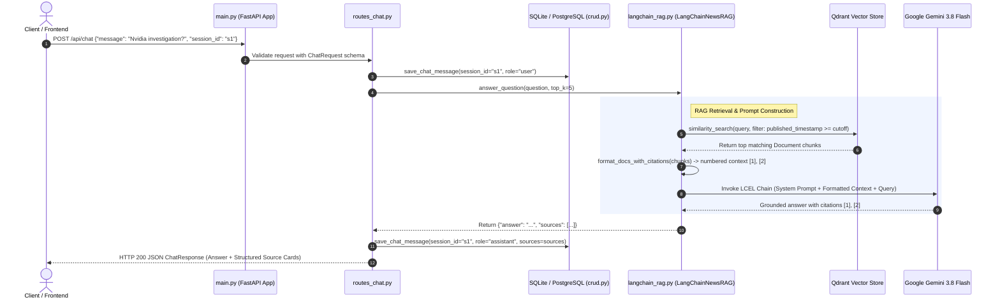
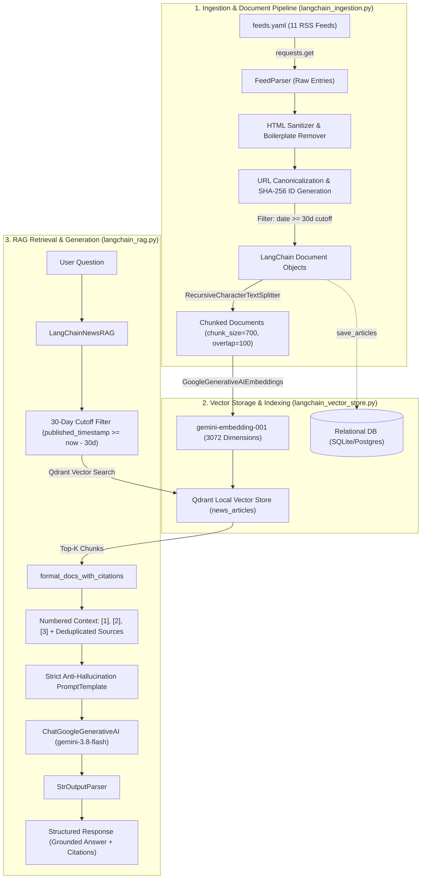
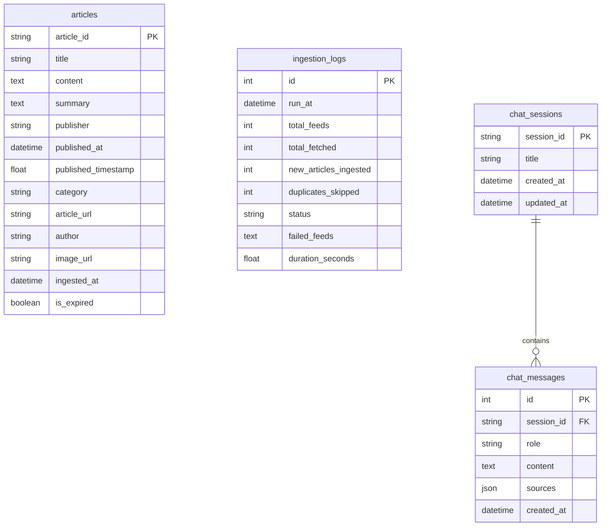

# AI-Powered News Intelligence Chatbot: Backend & RAG Architecture Documentation

> **Version:** 1.0.0  
> **Framework:** FastAPI | LangChain | Qdrant | Google Gemini  
> **Last Updated:** November 2026

---

## Table of Contents
1. [Executive Summary](#1-executive-summary)
2. [Project Architecture & Directory Layout](#2-project-architecture--directory-layout)
3. [End-to-End API Architecture & Call Flow](#3-end-to-end-api-architecture--call-flow)
   - [API Request Lifecycle Diagram](#api-request-lifecycle-diagram)
   - [Route Handlers, Schemas & Database Calls](#route-handlers-schemas--database-calls)
4. [LangChain RAG Architecture & Implementation](#4-langchain-rag-architecture--implementation)
   - [RAG Architecture Diagram](#rag-architecture-diagram)
   - [Phase-by-Phase Component Breakdown](#phase-by-phase-component-breakdown)
   - [Strict 30-Day Retention & Anti-Hallucination Design](#strict-30-day-retention--anti-hallucination-design)
5. [Database Layer & Data Models](#5-database-layer--data-models)
6. [Automated Scheduler & Retention Management](#6-automated-scheduler--retention-management)
7. [Configuration & Environment Variables](#7-configuration--environment-variables)
8. [CLI Commands & Verification Runbook](#8-cli-commands--verification-runbook)

---

## 1. Executive Summary

The **AI-Powered News Intelligence Chatbot** is an enterprise-grade backend engineered to scrape, process, index, and query up-to-the-minute global news from curated RSS feeds.

### Key Capabilities:
- **Strict 30-Day Time Horizon:** Enforces a rigid 30-day temporal cutoff. News older than 30 days is automatically purged from both the vector store and the relational database, preventing outdated answers.
- **LangChain-Native RAG:** Built entirely on top of the modern **LangChain** ecosystem (`langchain-core`, `langchain-google-genai`, `langchain-qdrant`, and `langchain-text-splitters`).
- **Grounded Anti-Hallucination Engine:** Gemini 3.8 Flash is instructed to answer strictly from retrieved excerpts. Every factual claim is cited with inline bracket markers `[1]`, `[2]`, mapped to verified source URLs. If the facts are missing, it refuses to guess.
- **Resilient Multi-Engine Storage:** Features automatic fallback from PostgreSQL to a local SQLite database, alongside an on-disk embedded Qdrant vector database using Google's 3072-dimensional `gemini-embedding-001` model.

---

## 2. Project Architecture & Directory Layout

The backend follows a modular, layer-separated structure:

```text
backend/
│
├── main.py                          # FastAPI application entry point, lifespan, & CLI verification
├── feeds.yaml                       # 11 Curated RSS feeds categorized across Tech, Business, World, Science
├── requirements.txt                 # Pinned dependencies (FastAPI, LangChain, Qdrant, Google GenAI, etc.)
│
├── app/
│   ├── config.py                    # Pydantic Settings reading .env with automatic defaults
│   │
│   ├── api/                         # Presentation Layer (HTTP Request/Response Handlers)
│   │   ├── routes_chat.py           # POST /api/chat, POST /api/chat/stream, GET /api/chat/history/{id}
│   │   ├── routes_news.py           # GET /api/news, GET /api/news/categories
│   │   ├── routes_health.py         # GET /api/health, GET /api/stats
│   │   └── routes_admin.py          # POST /api/admin/trigger-ingest, POST /api/admin/trigger-cleanup
│   │
│   ├── core/                        # Business Logic & RAG Intelligence Engine
│   │   ├── langchain_ingestion.py   # RSS scraping, HTML sanitizing, SHA-256 deduplication, LangChain chunking
│   │   ├── langchain_vector_store.py# Qdrant client singleton, 3072-dim embeddings, collection management
│   │   ├── langchain_rag.py         # LCEL RAG chain, time-filtered retriever, citations, anti-hallucination prompt
│   │   └── scheduler.py             # APScheduler jobs for hourly news sync and daily 30-day purge
│   │
│   ├── db/                          # Persistence Layer (Relational Storage)
│   │   ├── database.py              # SQLAlchemy engine initialization with SQLite auto-fallback
│   │   ├── models.py                # Database tables: articles, ingestion_logs, chat_sessions, chat_messages
│   │   └── crud.py                  # Database queries: deduplication checks, message logging, article expiry
│   │
│   ├── schemas/                     # Validation Layer (Pydantic DTOs)
│   │   ├── chat.py                  # ChatRequest, ChatResponse, SourceCitation
│   │   └── news.py                  # CleanedArticle, ArticleChunk, IngestionStats
│   │
│   └── utils/                       # Supporting Helpers
│       ├── date_utils.py            # UTC date parsing, ISO-8601 formatting, epoch conversion
│       └── logger.py                # Structured console and file logger
│
└── data/                            # Persistent On-Disk Storage (Git-Ignored)
    ├── qdrant/                      # Embedded Qdrant vector database (SQLite + HNSW storage)
    └── news.db                      # Local SQLite database (fallback for chat history and news metadata)
```

---

## 3. End-to-End API Architecture & Call Flow

### API Request Lifecycle Diagram

The following sequence diagram illustrates how an incoming user query moves across the API layer, Pydantic schemas, LangChain RAG pipeline, Qdrant vector store, and database.



---

### Route Handlers, Schemas & Database Calls

#### 1. Chat & Streaming Endpoints (`app/api/routes_chat.py`)
- **`POST /api/chat`**:
  - **Schema:** Validates input with `ChatRequest` (`message`, `session_id`, `category`, `top_k`).
  - **DB Action:** Calls `save_chat_message()` to persist the user's prompt in `chat_messages`.
  - **Core Call:** Invokes `LangChainNewsRAG().answer_question()`.
  - **DB Action:** Persists the assistant's answer and cited sources in `chat_messages`.
  - **Response:** Formats output into `ChatResponse` with a list of `SourceCitation` objects.
- **`POST /api/chat/stream`**:
  - Uses FastAPI `StreamingResponse` with `media_type="text/event-stream"`.
  - Calls `LangChainNewsRAG().stream_answer()`.
  - Yields real-time Server-Sent Events: `data: {"token": "..."}`, followed by `data: {"sources": [...]}`, ending with `data: [DONE]`.
- **`GET /api/chat/history/{session_id}`**:
  - Queries `ChatMessageModel` ordered chronologically by `created_at` to restore conversation threads.

#### 2. News Exploration Endpoints (`app/api/routes_news.py`)
- **`GET /api/news`**:
  - Parameters: `category` (optional), `limit` (default: 20), `offset` (default: 0).
  - Calculates the 30-day cutoff using `get_cutoff_timestamp()`.
  - Calls `get_recent_articles(db, cutoff_timestamp, category)` to query unexpired articles from the database.
- **`GET /api/news/categories`**:
  - Returns active categories configured across the RSS feeds (`Technology`, `Business`, `World News`, `Politics`, `Science`).

#### 3. Health & Analytics Endpoints (`app/api/routes_health.py`)
- **`GET /api/health`**:
  - Returns service status `HEALTHY`, timestamp, and current version.
- **`GET /api/stats`**:
  - Queries `ArticleModel` for total active articles within the 30-day retention window.
  - Queries the Qdrant client for collection status (`green`) and exact indexed vector count.

#### 4. Administrative Control (`app/api/routes_admin.py`)
- **`POST /api/admin/trigger-ingest`**:
  - Manually executes `scheduler_manager.run_ingestion_pipeline()`.
  - Returns count of newly fetched and stored articles.
- **`POST /api/admin/trigger-cleanup`**:
  - Manually executes `scheduler_manager.run_cleanup_pipeline()`.
  - Purges vectors and database rows older than 30 days.

---

## 4. LangChain RAG Architecture & Implementation

### RAG Architecture Diagram

The diagram below outlines the dual-track RAG system: the automated ingestion flow on the left and the user query flow on the right.



---

### Phase-by-Phase Component Breakdown

#### Phase 2: LangChain Ingestion (`app/core/langchain_ingestion.py`)
- **RSS Parsing:** Reads 11 feeds from `feeds.yaml` using `feedparser`.
- **Sanitization:** `clean_html()` strips script, style, iframe, and advertising tags using `BeautifulSoup`.
- **Deduplication:** Strips tracking parameters (`utm_*`, `fbclid`, `ref`) and hashes the canonical URL with SHA-256 to create deterministic `article_id`s.
- **Document Creation:** Wraps content into `langchain_core.documents.Document`:
  - `page_content`: Title + cleaned article text.
  - `metadata`: `article_id`, `title`, `publisher`, `published_at`, `published_timestamp`, `url`, `category`.
- **Chunking:** `RecursiveCharacterTextSplitter` configured with `chunk_size=700` and `chunk_overlap=100` splits long articles into coherent sections, tagging each with a unique `chunk_id`.

#### Phase 3: LangChain Vector Store (`app/core/langchain_vector_store.py`)
- **Embeddings Model:** `GoogleGenerativeAIEmbeddings(model="models/gemini-embedding-001")`, producing **3072-dimensional** vectors.
- **Qdrant Singleton Client:** Local file-based Qdrant instances lock disk storage exclusively. A singleton `_qdrant_client` guarantees that multiple threads share the same connection without `portalocker` collisions.
- **Collection Setup:** Automatically initializes collection `news_articles` with `Distance.COSINE` and vector size 3072. If a legacy 768-dim collection is detected, it recreates it safely.
- **Batch Storage:** `add_documents_to_qdrant()` embeds and uploads documents in batches of 16 chunks with RPM throttling.

#### Phase 4: LangChain RAG Chain (`app/core/langchain_rag.py`)
- **Dual-Layer Time-Filtered Retrieval:**
  1. *Qdrant Native Filter:* Queries Qdrant with `qmodels.FieldCondition(key="metadata.published_timestamp", range=Range(gte=cutoff))`.
  2. *In-Memory Safety Guard:* Verifies timestamps in-memory before formatting context to guarantee no stale news slips through.
- **Context & Citation Formatter (`format_docs_with_citations`):**
  - Formats retrieved chunks into numbered blocks:
    ```text
    [1] Title: Democrats launch Nvidia investigation...
        Publisher: TechCrunch | Published: 2026-11-12 | Category: Technology
        Excerpt: Congressional inquiry into Nvidia China sales...
    ```
  - Deduplicates articles by URL to assemble clean source metadata cards.
- **Strict Anti-Hallucination Prompt:**
  ```text
  You are a precise, objective News Intelligence AI assistant.
  Your goal is to answer the user's question using ONLY the provided verified news excerpts from the last 30 days.

  CRITICAL RULES:
  1. STRICT GROUNDING: Answer ONLY based on the facts provided in the Context.
  2. INLINE CITATIONS: Every factual assertion MUST cite its source using [1], [2].
  3. INSUFFICIENT INFORMATION: If facts are missing, respond EXACTLY with:
     "I do not have verified news from the past 30 days to answer this question."
  4. OBJECTIVE TONE: Summarize clearly without opinion or bias.
  ```
- **LCEL Chain:**
  ```python
  rag_chain = PROMPT_TEMPLATE | self.llm | StrOutputParser()
  ```
- **Model:** `ChatGoogleGenerativeAI(model="gemini-3.8-flash", temperature=0.2)`.

---

### Strict 30-Day Retention & Anti-Hallucination Design

The system implements a **three-tier temporal defense**:

| Defense Tier | Where it Happens | How it Works |
| :--- | :--- | :--- |
| **Tier 1: Ingestion Gate** | `langchain_ingestion.py` | Before creating any Document, `parse_date_to_utc()` verifies `epoch_ts >= cutoff`. Articles older than 30 days are discarded at the door. |
| **Tier 2: Retrieval Gate** | `langchain_rag.py` | Qdrant vector queries enforce `Range(gte=now - 30d)`. A secondary in-memory filter rejects any chunk older than 30 days. |
| **Tier 3: Daily Scheduled Purge** | `scheduler.py` | Every night at 00:00 UTC, a batch delete removes all vector points and DB rows where `published_timestamp < cutoff`. |

---

## 5. Database Layer & Data Models

### Database Fallback Strategy (`app/db/database.py`)
Production systems often configure PostgreSQL via `.env`. If a local PostgreSQL instance is unreachable (e.g. port blocked, credentials not configured), `database.py` catches the connection error and automatically initializes an embedded SQLite database at `backend/data/news.db`.

### Relational Schema Models (`app/db/models.py`)



---

## 6. Automated Scheduler & Retention Management

Implemented in `backend/app/core/scheduler.py` via `APScheduler`:

1. **Periodic Ingestion Job (`recurring_news_ingestion`):**
   - **Trigger:** `IntervalTrigger(hours=12)` (configurable via `INGESTION_INTERVAL_HOURS`).
   - Fetches existing article IDs from the database to avoid duplicate work.
   - Fetches fresh articles from `feeds.yaml`.
   - Embeds new chunks into Qdrant.
   - Saves parent article metadata to SQLite/PostgreSQL.
   - Records run statistics in `ingestion_logs`.

2. **Daily 30-Day Retention Purge Job (`daily_retention_cleanup`):**
   - **Trigger:** `CronTrigger(hour=0, minute=0, timezone="UTC")`.
   - Computes `cutoff_timestamp = now - 30 days`.
   - Deletes vectors from Qdrant via `qmodels.FilterSelector`.
   - Executes `DELETE FROM articles WHERE published_timestamp < cutoff_timestamp`.

3. **FastAPI Lifespan Integration (`main.py`):**
   - On server startup, `lifespan` initializes database tables and starts `scheduler_manager.start_scheduler()`.
   - On server shutdown, it cleanly stops the background scheduler without hanging worker threads.

---

## 7. Configuration & Environment Variables

Managed by `app/config.py` using `pydantic-settings` to parse the root `.env` file:

| Variable | Default Value | Description |
| :--- | :--- | :--- |
| `GEMINI_API_KEY` | *(Required)* | Google Gemini API Key for Embeddings and Chat. |
| `GEMINI_MODEL` | `gemini-3.8-flash` | LLM model for RAG question answering. |
| `GEMINI_EMBEDDING_MODEL` | `gemini-embedding-001` | Embedding model producing 3072-dim vectors. |
| `EMBEDDING_DIMENSION` | `3072` | Vector size configured in Qdrant collection. |
| `DATABASE_URL` | `sqlite:///./data/news.db` | Database connection string (PostgreSQL or SQLite). |
| `QDRANT_STORAGE_PATH` | `data/qdrant` | Local on-disk directory for embedded Qdrant. |
| `QDRANT_COLLECTION_NAME` | `news_articles` | Name of the Qdrant vector collection. |
| `RETENTION_DAYS` | `30` | Strict temporal retention limit in days. |
| `INGESTION_INTERVAL_HOURS`| `12` | Frequency of automated RSS background sync. |

---

## 8. CLI Commands & Verification Runbook

### Activate Virtual Environment
```powershell
cd backend
.\.venv\Scripts\Activate.ps1
```

### Start the Development API Server
```powershell
python main.py
```
- Swagger UI Documentation: `http://localhost:8000/docs`
- ReDoc Alternative: `http://localhost:8000/redoc`
- Health Endpoint: `http://localhost:8000/api/health`

### Run Built-in Phase Verification Suites
Each core module contains a standalone `if __name__ == "__main__":` block for testing without external runners:

```powershell
# 1. Verify LangChain Ingestion & 30-day chunking
python -m app.core.langchain_ingestion

# 2. Verify Qdrant Vector Store & 3072-dim Google Embeddings
python -m app.core.langchain_vector_store

# 3. Verify LangChain RAG Engine (Grounding & Citations)
python -m app.core.langchain_rag

# 4. Verify Scheduler & 30-day Retention Cleanup
python -m app.core.scheduler

# 5. Verify All FastAPI Endpoints (TestClient suite)
python main.py --test
```
